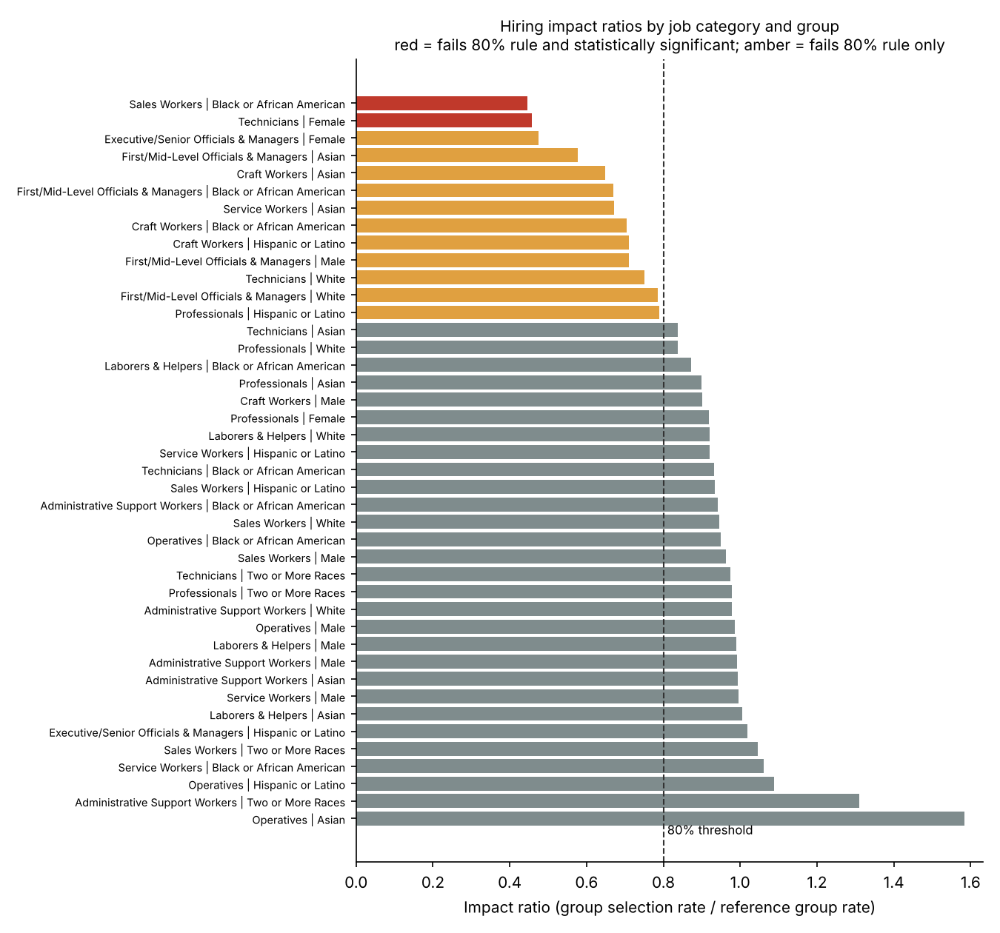

# Workforce Compliance Analytics: EEO-1 Reporting and Adverse Impact Review


An end-to-end compliance analytics workflow on **simulated** HR data. It reconciles an HR
system extract against an applicant-tracking extract, produces an EEO-1 style workforce
report that ties out to source headcounts, and tests hiring outcomes for adverse impact
using the four-fifths rule and a two-proportion z-test.

**Stack:** SQL (SQLite) · Python (pandas) · Excel (COUNTIFS report, tie-out controls; Power Query / PivotTable ready)

> All data is synthetic. No real employee or applicant information is used.

## Results at a glance

| Step | Result |
|---|---|
| Control checks | 7 checks, 282 exceptions, **every planted issue caught with zero false positives** |
| EEO-1 report | 5,632 active employees; 5,554 reported, 78 held for HR follow-up; **tie-out difference 0** |
| Excel vs SQL | Every EEO-1 cell recomputed in Excel with COUNTIFS; **matches SQL exactly** |
| Adverse impact | **2 groups flagged** (both were planted); 22 more below 80% but not significant, listed for monitoring |

Read the one-page stakeholder summary: **[docs/summary.md](docs/summary.md)**



## How it works

```
data/raw/hris_employees.csv ─┐
data/raw/ats_applicants.csv ─┼─► SQLite ─► 01_checks.sql ─► exceptions ─► reconciliation vs answer key
data/reference/*.csv ────────┘              02_clean.sql  ─► clean_hris, snapshot_workforce
                                            03_eeo1.sql   ─► eeo1_summary, eeo1_tieout, applicant_pool
                                                                   │
                                     adverse_impact.py ◄───────────┘
                                                                   │
                       outputs/*.csv · outputs/eeo1_workbook.xlsx · docs/summary.md · docs/impact_ratios.png
```

### 1. Simulated data with an answer key (`src/generate_data.py`)
- ~6,300 HRIS rows and 10,000 applicant records across 20 job titles and the 10 EEO-1 job categories.
- Plants known data problems and two hiring disparities, and records every one in
  `data/raw/planted_issues.json`. That answer key lets the pipeline **prove** its checks work.

### 2. Control checks (`sql/01_checks.sql`)

| Check | What it catches | Resolution (`sql/02_clean.sql`) |
|---|---|---|
| `duplicate_employee_id` | Same employee loaded more than once | Keep one row |
| `missing_demographics` | Blank sex or race/ethnicity | Keep in headcount, report as "Not reported", HR follow-up |
| `unmapped_job_title` | Title variants with no EEO-1 mapping (e.g. "Sr. Data Analyst") | Remap through `title_aliases.csv` |
| `invalid_hire_date` | Malformed (`2024-13-40`) or future dates | Exclude until corrected |
| `ats_hire_missing_in_hris` | Applicant marked Hired, no employee record | Confirm start or rescinded offer |
| `hris_hire_missing_in_ats` | Employee hired in the ATS window with no applicant record | Kept; confirm with Recruiting |
| `demographic_mismatch` | Sex/race differs between ATS and HRIS | HRIS is the system of record |

### 3. EEO-1 report and tie-out (`sql/03_eeo1.sql`)
Active workforce on the snapshot date (31 Dec 2025), counted by job category × race/ethnicity × sex.
The tie-out proves every employee is either in the report or on the follow-up list:

```
snapshot headcount − reported in EEO-1 − not reported = 0
```

### 4. Adverse impact (`src/adverse_impact.py`)
For each job category, applicants with a completed decision (Hired or Rejected) are grouped by
sex and by race/ethnicity.
- **Selection rate** = hired ÷ applicants
- **Impact ratio** = group rate ÷ highest group rate (the benchmark group needs 100+ applicants)
- **Four-fifths rule:** ratio below 0.80 indicates possible adverse impact (Uniform Guidelines, 29 CFR 1607.4(D))
- **Two-proportion z-test:** is the gap larger than chance would explain (p < 0.05)?

A group is flagged as *adverse impact indicated* only when it fails both tests and has 30+ applicants.
Groups failing just one test are listed for review. This separates real gaps from small-sample noise.

### 5. Excel workbook (`outputs/eeo1_workbook.xlsx`)

| Sheet | Contents |
|---|---|
| About | Guide, colour key, steps to rebuild the report with Power Query and a PivotTable |
| Workforce | Clean snapshot workforce as an Excel table |
| EEO-1 Report | 10 × 14 matrix, every cell a `COUNTIFS` formula |
| Tie-Out | Excel totals vs SQL totals, with a PASS/FAIL control cell |
| Adverse Impact | Rates, impact ratios and 80% test as formulas; flagged rows highlighted |
| Exceptions | Reconciliation summary and every exception record |

## Run it

```bash
python -m venv .venv && source .venv/bin/activate     # Windows: .venv\Scripts\activate
pip install -r requirements.txt

python src/generate_data.py      # writes data/raw/ (seed 42 by default)
python src/run_pipeline.py       # writes outputs/ and docs/
pytest -q                        # 6 tests, including a different random seed
```

## Repository layout

```
├── data/
│   ├── raw/              generated HRIS + ATS extracts and the planted-issue answer key
│   └── reference/        EEO-1 job title map and title alias table
├── sql/                  01_checks · 02_clean · 03_eeo1
├── src/                  generate_data · run_pipeline · adverse_impact · build_workbook · report
├── outputs/              exceptions, reconciliation, EEO-1 report, adverse impact, workbook
├── docs/                 stakeholder summary and chart
└── tests/                end-to-end tests (also run in GitHub Actions)
```

## Limitations
- Simulated data. A real review would also look at job-relatedness, business necessity and requisition-level detail.
- Applicants who did not self-identify are excluded from that dimension.
- Many comparisons run at once, so some significant results can occur by chance. Flagged findings should be confirmed at the requisition level.
