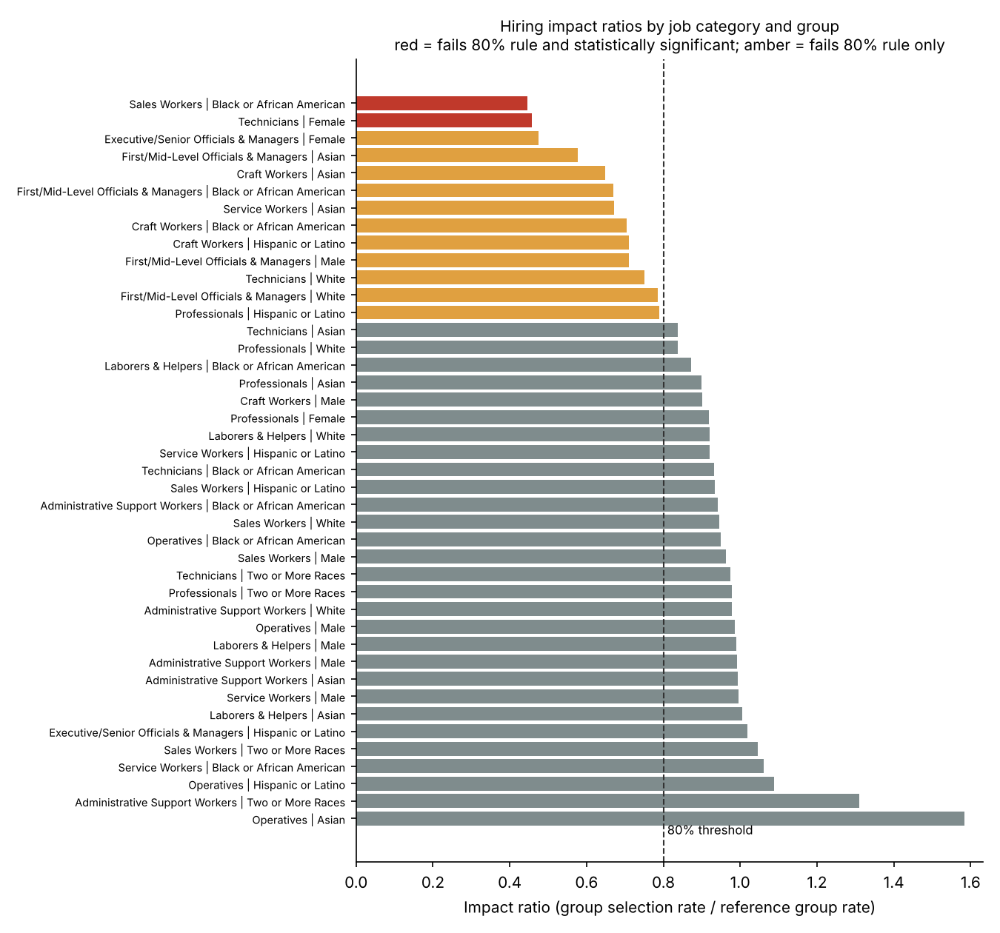

# Workforce Compliance Review: Summary of Findings

*Snapshot date: 2025-12-31. All data is simulated for demonstration.*

## 1. Data quality and reconciliation

Seven control checks compared the HR system (HRIS) with the applicant-tracking system (ATS). They raised **282 exceptions**, and every check caught exactly the records that were planted in the data (7 of 7 checks passed).

| Check | Records caught | How it was resolved |
|---|---:|---|
| missing demographics | 90 | Kept in headcount, listed for HR follow-up |
| unmapped job title | 45 | Remapped through the title alias table |
| invalid hire date | 12 | Excluded until HR corrects the date |
| duplicate employee id | 60 | Kept one row per employee |
| demographic mismatch | 30 | HRIS used as system of record; listed for review |
| ats hire missing in hris | 25 | Listed for HR to confirm start or rescinded offer |
| hris hire missing in ats | 20 | Kept in headcount; listed for Recruiting to confirm |

## 2. EEO-1 workforce summary

- Active workforce on the snapshot date: **5,632**
- Reported in the EEO-1 table: **5,554**
- Held back because sex or race was not reported: **78**
- Tie-out difference: **0** (every employee is accounted for)

## 3. Hiring adverse impact

Each group's hiring rate was compared with the highest-rate group in the same job category (minimum 100 applicants to serve as the benchmark). A group is flagged when its rate is below 80% of the benchmark (the four-fifths rule) **and** a two-proportion z-test shows the gap is unlikely to be chance (p < 0.05).

| Job category | Group | Applicants | Hire rate | Benchmark rate | Impact ratio | p-value |
|---|---|---:|---:|---:|---:|---:|
| Sales Workers | Black or African American | 173 | 13.9% | 31.1% (Asian) | 0.45 | 0.0003 |
| Technicians | Female | 515 | 11.8% | 25.9% (Male) | 0.46 | <0.0001 |

A further **22 group comparisons** fall below 80% without a statistically significant gap; 11 of them involve fewer than 30 applicants, where one or two hires swing the ratio. These are listed in `outputs/adverse_impact.csv` for monitoring rather than action.

## 4. Recommended next steps

1. Review the selection process for the two flagged groups (job requirements, interview panels, requisition-level results) with Talent and Recruiting.
2. Send the HR follow-up list (missing demographics, invalid dates, unmatched hires) to the HRIS team and re-run the pipeline once corrected.
3. Add the title alias table to the monthly refresh so new title variants are caught early.

## 5. Limitations

- Data is simulated; real reviews also consider job-relatedness and business necessity.
- Applicants who did not self-identify are excluded from that dimension's analysis.
- Many comparisons are run at once, so a few significant results can occur by chance; findings should be confirmed at the requisition level.
